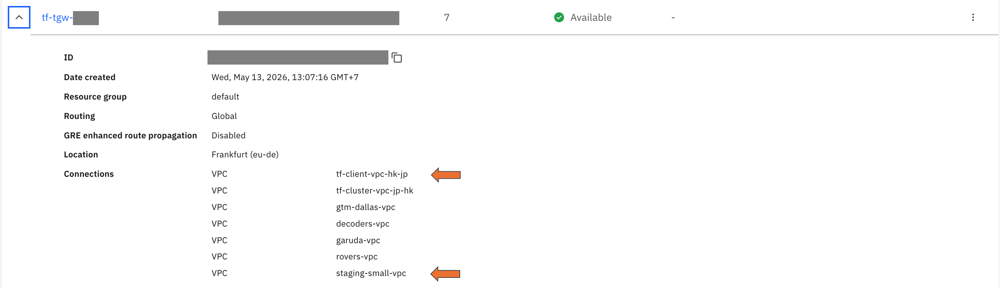

========================================
External pool member troubleshooting
========================================

Check list:
    - Ensure there is route from TMM to pool member
    - TGW connectivity is required for remote VSI.
    - Security group rule is required to be open from both cluster (TMM) and destination side.

Origin server reachability
=====================================================

Route from TMM to pool member
-----------------------------

Example: Origin server IP address ``10.248.69.X``

.. code-block:: text

   /bdt_cli route | grep 10.248
   routeType:0 isIpv6:false destNet:{ip:{addr:10.248.69.0, rd:0} pl:24} gw:{ip:{addr:10.103.66.1, rd:0}} gwType:1 interface:external-vlan unresolved:false
   routeType:0 isIpv6:false destNet:{ip:{addr:10.248.69.0, rd:0} pl:24} gw:{ip:{addr:10.104.130.1, rd:0}} gwType:0 unresolved:true
   routeType:0 isIpv6:false destNet:{ip:{addr:10.248.69.0, rd:0} pl:24} gw:{ip:{addr:10.102.18.1, rd:0}} gwType:0 unresolved:true

Route on IBM cloud
------------------

* If VSI is in same VPC as cluster, connectivity is already available (Directly Connected)
* Else, add a static route to origin server IP or origin server's network address

Security group
--------------

* Outbound rule on K8S node NIC, if not ``allow all``:
    - source: external-vlan CIDR of K8S cluster node nic
    - destination: Origin Server
    - L4 Proto: TCP
    - L4 Port: listening port on Origin Server. Example: ``18072``

* Inbound rule for VPC:
    - source: external-vlan CIDR of K8S cluster node nic
    - destination: Origin Server
    - L4 Proto: TCP
    - L4 Port: listening port on Origin Server. Example: ``18072``

